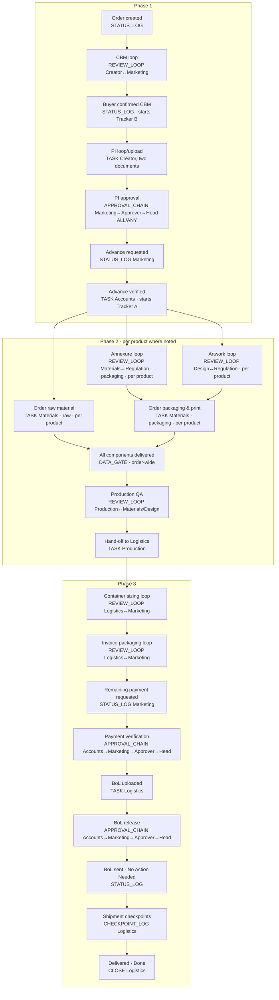

# DocFlow v2 — gap analysis, open questions and build plan

**Status:** draft for the owner, 20 Oct 2026. No product code has been written for v2.
**Source:** `docs/v2-brief.md` (the owner's brief, verbatim). Answers will be recorded in `docs/decisions.md` as D24 onward. Neither `docs/URS.md` nor `docs/v2-brief.md` is ever edited.

## 0. How to answer this

- **Questions (section 3)** are numbered (Q1, Q2, …). Each has **my recommendation** in *italics*. You can answer only the ones you care about and say "recommendations for the rest". Where you disagree, a one-line answer is enough.
- **Contradictions in the brief (section 2)** need a ruling each. Each one also has a recommendation.
- **Data safety (section 6):** pick one option.
- **After you answer,** I record the decisions and start Phase V1 (section 7). Each phase ends at a Gate and a PR you merge, as in v1.

---

## 1. What v2 is, in one paragraph

v1 routes **one document** through **one chain of people**. v2 tracks an **export order** from first quote to delivery.

- **Many parties:** named individuals (Marketing, Approver, Head Approver) and team pools (Regulation, Materials, Design, Production, Accounts, Logistics) each work on their own part.
- **Parallel branches:** these sometimes run at the same time and rejoin later.
- **Revision loops:** several separate back-and-forth loops, each recorded as its own history.
- **Configurable gates:** approval gates that need everyone, or any one person, as configured.
- **Two document versions:** with and without rates, each seen by different teams.
- **Live tracking:** a per-product table of materials, edited continuously.
- **Three clocks** and a full timeline.

**Bottom line:** the v1 engine, its step model and its role rules don't stretch to this. They get replaced. The surrounding platform survives: sign-in, storage, emails, hosting, backups, testing and security.

---

## 2. Contradictions inside the brief (need a ruling each)

| # | Where | The two readings | My recommendation |
|---|---|---|---|
| **C1** | Notifications on a revert | **Part A:** "a revert does not email the team it lands back on." **Cross-cutting 6:** "Regulation rejecting the annexure back to Materials **does** email Materials once… whether that's the chain moving forward… or a revert landing back on a team that already acted before." | *Follow Cross-cutting 6: email whoever newly becomes the current actor, including after a revert, but never for rounds where the ball didn't change hands. Silent reverts let returned work sit unnoticed, which defeats "days pending". The exact rule is in §4.11.* |
| **C2** | How long Materials can edit the component table | **Part A:** "…the chain hasn't advanced past **material receipt**." **Part B:** "…hasn't yet advanced past **Production hand-off**." | *Editable until Production hands off to Logistics (Part B). Production QA can send work back to Materials after receipt (Phase 2 step 6), and Materials then needs to correct rows.* |
| **C3** | Tracker A's starting point | **Name:** "Days since **PI approved**." **Definition:** "(= Phase 2 / production start)", which Phase 1 step 10 places at **Accounts verifying the advance payment**. These are different moments, possibly weeks apart (PI sent → buyer pays → Accounts verifies). | *Production start: Accounts' verification. That's what Phase 2 and the dashboards are about. Rename it "Days since production start" and show the PI-approval date alongside.* |
| **C4** | Whether the raw-material branch waits for Regulation | **Phase 2 step 1:** raw material "runs independently… not gated on anything." **Step 2:** "Neither the raw-material branch nor the chain overall advances past this point until BOTH the annexure and the artwork are confirmed." | *The raw-material ordering task starts at once and runs freely. What waits for both confirmations is the packaging-ordering task (step 3), plus the chain's move to Production QA, which also needs everything delivered. Step 2's mention of "the raw-material branch" is read as "the order as a whole can't reach Production before then".* |
| **C5** | Which three counters | **Cross-cutting 3:** A (production start), B (chain start), C (per-team active days). **Component table note:** "Tracker A, Tracker C, **and a PI/PO-anchored day count**". | *The three counters are A, B and C everywhere. On the component table, also show a per-row "days since PO date" (needs Q38), because that's what a buyer-facing materials tracker usually means. Confirm or correct.* |
| **C6** | When Phase 3 ends | **Overview:** "Ends when the buyer confirms receipt of the **Bill of Lading**." **Steps 8–9:** Logistics closes the order when the buyer has received **the shipment**. | *Steps 8–9: Logistics closes on delivery of the goods, and the order becomes Done. Releasing the BoL makes it "No Action Needed".* |
| **C7** | Who the Head Approver step can be | **Phase 1 step 8:** the Head Approver is "a single required approver". **Part A** and actor model: "Head Approver(s)", with an ALL/ANY gate, a group. | *Not a real conflict. Every Head Approver step is a group of one or more named people with an ALL/ANY gate. Phase 1's happens to be one person on ALL, by configuration.* |
| **C8** | Who marks the advance payment | The open-questions list asks "who marks advance payment received — Marketing, Accounts, or either?", but Part A already answers it: **Accounts**. | *Treat as answered (Accounts). What remains open is Q10: is Accounts alone enough?* |

---

## 3. Open questions

### 3.1 Actors, roles and who can do what

- **Q1. Who is the Creator?** The brief names two actor models: team pools (six teams) and named individuals (Marketing, Approver, Head Approver). The Creator, who drafts the CBM and PI, is in neither.
  *Recommendation: a named individual per order, chosen when the order is created (Marketing picks or is assigned one), with a pool of eligible "Creator" people kept in Employee Master.*
- **Q2. Who creates an order in the app?** Phase 1 step 2 says the chain "begins" when Marketing relays requirements to the Creator, but nothing says who presses "New order", or what it holds: buyer, company, products, the named people.
  *Recommendation: Marketing creates the order (buyer, company, notes on the requirements, Creator). That's the first logged event.*
- **Q3. Is the buyer a master record or free text?** Dashboards filter by buyer name, and the PI has a buyer name and address.
  *Recommendation: a Buyer Master (name, address, country, contact) chosen per order, so the filter is reliable and the name is spelled one way.*
- **Q4. What happens to the CFO?** v1's central role doesn't appear in v2. Is it removed, or is the CFO now a Head Approver?
  *Recommendation: remove the CFO role. If your CFO approves, they're named as a Head Approver.*
- **Q5. Are Marketing, Approver and Head Approver eligibility lists?** Should Employee Master mark who may be put in each slot, so pickers only offer eligible people?
  *Recommendation: yes. Each person gets flags such as "can be Marketing", "can be Approver" and "can be Head Approver", alongside any number of team memberships.*
- **Q6. Self-approval for named actors (brief's own question).** Can one person fill two slots on the same order, for example Marketing and Head Approver, and then act on both?
  *Recommendation: one person may not fill two named slots in the same chain (PI approval, payment verification, BoL release), and the Creator may not fill any approval slot on their own order. Team pools are unrestricted, as the brief says.*
- **Q7. What happens when a named person leaves?** v1 had Admin reassign.
  *Recommendation: keep it. Admin can replace a named person on any open step, and the change is logged.*
- **Q8. Dashboards for people in several teams (the brief asks me to choose).**
  *Recommendation: one dashboard with a tab per team or slot, plus an "All my work" tab. Separate dashboards mean more clicking for people in several teams, while tabs keep one combined urgency view. Tradeoff: the page has more tabs for multi-team people.*
- **Q9. What can Admin see and do in v2?**
  *Recommendation: the same as v1. Admin sees everything read-only, manages the masters and the workflow configuration, and reassigns. Admin doesn't act on steps.*

### 3.2 Phase 1

- **Q10. Is Accounts alone enough for the advance payment (brief's own question)?** Phase 3 uses a four-stage chain.
  *Recommendation: keep it as described (Accounts alone). Because chains are configuration (§4.3), adding stages later is a settings change, not a rebuild.*
- **Q11. Is the CBM loop a formal reject (brief's own question)?**
  *Recommendation: formal. Marketing either confirms or returns it with a required comment, and every round is a recorded revision. It isn't just a chat.*
- **Q12. Is the CBM a file, structured data, or both?**
  *Recommendation: an uploaded file (PDF/XLSX/DOCX) plus optional notes. A built-in container calculator is out of scope.*
- **Q13. Is "sent to the buyer and confirmed" its own logged step (brief's own question)?** It anchors Tracker B.
  *Recommendation: yes. Marketing presses "Buyer confirmed CBM", which is logged with a date, and that starts Tracker B. Marketing can back-date it if the buyer confirmed earlier.*
- **Q14. Is "Marketing tells the Creator to draft the PI" (step 6) its own action, or automatic once the CBM is confirmed?**
  *Recommendation: automatic. The PI task opens for the Creator the moment the buyer confirmation is logged.*
- **Q15. Two PI versions: generated by the system or uploaded twice (brief's own question)?**
  *Recommendation: two uploads by the Creator, labelled "Full PI" and "PI without rates". The system can't reliably strip rates and buyer details out of an arbitrary PDF. Generating both from structured data is possible later, but only if the PI's line items are entered into the app, which is a much bigger build.*
- **Q16. In the PI approval chain, where does a rejection go (brief's own question)?**
  *Recommendation: back to the Creator, with a required reason. When the Creator resubmits, the chain restarts from Marketing. Approvals don't carry over, because the document changed.*
- **Q17. Can a PI be rejected for good, cancelling the order?** And more generally, can an order be cancelled at any point, and by whom?
  *Recommendation: there are no dead ends. Rejections return work for revision. Admin and Marketing can cancel an order at any stage, with a reason; cancelling stops every open task, and the order is kept read-only.*
- **Q18. Is "Marketing sends the PI and requests the advance" (step 9) logged?**
  *Recommendation: yes, as a status-only action ("Advance requested", with a date). Accounts' verification task opens at the same time.*
- **Q19. What does Accounts record when verifying a payment?**
  *Recommendation: date received, amount, currency, reference number, an optional proof upload and a comment.*

### 3.3 Phase 2

- **Q20. Is Materials one team with tagged tasks (brief's own question)?**
  *Recommendation: yes. One team called Materials, and each task carries the tag "raw material" or "packaging".*
- **Q21. Is raw-material ordering one task per order or one per product?** Step 1 says "per product".
  *Recommendation: one task per product. It completes when every raw-material row of that product is delivered.*
- **Q22. Does raw-material ordering need anyone's confirmation (brief's own question)?**
  *Recommendation: no. Its rows are filled in and the dates are the record.*
- **Q23. Are the annexure and artwork one per order or one per product?**
  *Recommendation: one per product. Packaging differs by product, and the brief's per-product tables point the same way. This multiplies the review loops: an order with 3 products has 3 annexure and 3 artwork loops.*
- **Q24. If the annexure is rejected, does the artwork review pause (brief's own question)?**
  *Recommendation: no. The two loops are independent.*
- **Q25. Is the packaging ordering/printing task (step 3) one per product, opening when that product's annexure and artwork are both confirmed, or one per order?**
  *Recommendation: one per product, so one slow product doesn't hold up the others.*
- **Q26. Who marks a component as delivered (brief's own question)?**
  *Recommendation: Materials only, by filling in the Deliver Date. Logistics has no role before Phase 3.*
- **Q27. Is a row delivered once Deliver Date is filled, and does received quantity matter (brief's own question)?**
  *Recommendation: Deliver Date filled means delivered. No received-quantity column. Partial deliveries can be written in the Trident Remark, or split into two rows.*
- **Q28. Is the "all delivered" gate per order or per product (brief's own question)?**
  *Recommendation: per order, as the brief's main wording says. Production QA is one task for the whole order.*
- **Q29. Where can Production QA send work back (brief's own question)?**
  *Recommendation: to Materials (with a raw-material or packaging tag) or to Design. Not to Regulation. If artwork must change, Design's change goes back through Regulation's artwork loop before returning to Production.*
- **Q30. What happens to Production QA after it sends work back?**
  *Recommendation: QA is on hold until the receiving team sends the fix back. QA then continues. The delivered gate isn't re-checked unless rows are edited.*
- **Q31. Can Production hand off part of an order to Logistics?**
  *Recommendation: no. Hand-off is for the whole order.*
- **Q32. Does Logistics need anything during Phase 2?** The brief gives Logistics the full PI from Phase 2 but no task until Phase 3.
  *Recommendation: Logistics can view the order and full PI from Phase 2, with no task until hand-off.*

### 3.4 Products and the component table

- **Q33. Catalogue or free text (brief's own question)?**
  *Recommendation: a simple Product Master and Component Master (names, type raw/packaging, unit), used to fill tables quickly. Rows still allow free text, for one-off components.*
- **Q34. Who enters an order's products and components, and when?**
  *Recommendation: the Creator lists products on the PI task (step 7). Materials adds and edits the component rows at Phase 2 start and at any time until hand-off.*
- **Q35. Is "PO Quantity" from a real purchase order (brief's own question)?**
  *Recommendation: it's just a number, with an optional PO upload per row. Please confirm what a PO is here: Trident's order to its supplier, or the buyer's order to Trident.*
- **Q36. What exactly do "Order Quantity" and "PO Quantity" mean, and do they differ?**
  *Need your answer. I can't recommend without knowing the business meaning.*
- **Q37. What are "TNS" and "Trident" in "TNS Remark" and "Trident Remark"?** The brief calls TNS "the manufacturer".
  *Recommendation: two free-text remark columns, labelled exactly as written.*
- **Q38. Tracker A and C on a row, plus a "PI/PO-anchored day count" (see C5).** What should each row show?
  *Recommendation: the row shows days since PO Date (or since dispatch, once dispatched). Trackers A and C belong to the order and the tasks, not to rows.*
- **Q39. Should every edit to a component row be logged with who, when, old value and new value?** The brief says "tracked means actor, role, timestamp, comment".
  *Recommendation: yes, every field change is logged with an optional comment, and is visible in the row's history and the timeline.*

### 3.5 Phase 3

- **Q40. Are the two Marketing ↔ Logistics loops formal gates (brief's own questions)?**
  *Recommendation: yes, like the CBM loop. Marketing confirms or returns with a required comment, and the chain can't move on until Marketing confirms.*
- **Q41. Is the true invoice a file upload, and who can see it?**
  *Recommendation: a file uploaded by Logistics. Rates are visible to Marketing, Accounts, Logistics, Production, the named approvers and Admin.*
- **Q42. Is the Approver in Phase 3 the same person as Phase 1's Approver 1 (brief's own question)?**
  *Recommendation: no, each chain stage is its own slot. The company configuration may of course name the same person in both.*
- **Q43. Are the payment chain and the BoL-release chain configured separately (brief's own question)?**
  *Recommendation: yes. Each has its own named people and its own ALL/ANY gate per stage.*
- **Q44. What does the BoL-release chain judge (brief's own question)?**
  *Recommendation: a general final sign-off with a free-text reason. Structured reasons can be added later.*
- **Q45. Where does a rejection in a 4-stage chain go (brief's own question)?**
  *Recommendation:*
  - *Payment chain: back to Accounts, as "payment not confirmed", with the reason. Marketing gets a task to chase the buyer, then Accounts re-verifies and the chain restarts.*
  - *BoL-release chain: the order goes on hold with the reason, until Marketing resolves it and restarts the release chain.*
- **Q46. Who produces the BoL, and is it a file?** Step 5 says "is generated".
  *Recommendation: Logistics uploads the BoL file, which opens the release chain. The app doesn't generate shipping documents.*
- **Q47. Is "released to the buyer" an action in the app?**
  *Recommendation: yes. Once the release chain completes, Logistics or Marketing marks "BoL sent to buyer", with a date. The order then shows "No Action Needed".*
- **Q48. Are shipment checkpoints free text or a fixed list (brief's own question)?**
  *Recommendation: both. A status chosen from a list Admin can edit (sailed, at port, customs, out for delivery, other), plus free text and a date. The latest status shows on dashboards.*
- **Q49. Is "Remaining payment requested" (step 3) a prerequisite for Accounts' verification, or only a log entry?**
  *Recommendation: it opens Accounts' verification task, the same pattern as Phase 1.*

### 3.6 Clocks, dashboards and timeline

- **Q50. Exactly how Tracker C counts (brief's own question).** In the owner's example, Materials held the annexure on day 1, and again from Regulation's rejection to the resubmission the next day, and the answer is 2 days. A "count every calendar day touched" rule gives 3 days there, because the rejection arrived on day 4. Two rules both give 2:
  - **Rule 1:** add up the time the team held the task, then round the total **up** to whole days.
  - **Rule 2:** count working sessions: each time the task comes back to the team counts as one day, however long they took.

  *Recommendation: Rule 1. It's generic ("time as current holder"), the same rule applies to every team, and dashboards also show hours for anything under a day.*
- **Q51. Calendar days or working days?** Should weekends and holidays count, on all three trackers?
  *Recommendation: calendar days in India time, with no holiday calendar.*
- **Q52. Does Tracker C apply in Phase 3 (brief's own question)?**
  *Recommendation: yes. It's the same generic rule, so it's free everywhere. Dashboards show it wherever a team holds a task.*
- **Q53. Do Phase 3 dashboards sort and filter the same way (brief's own question)?**
  *Recommendation: yes. Every dashboard puts the oldest pending task first by default, and offers buyer, company, dates, stage and task-type filters where relevant.*
- **Q54. "Longest-pending first": measured from when the task last came to them, or from when the task first opened?**
  *Recommendation: from when it last came to them, and the time it has spent with them in total (Tracker C) is shown too.*
- **Q55. What should the timeline look like?**
  *Recommendation: a top-to-bottom flowchart of the order's phases and steps. Each revision loop shows as a numbered series of rounds (who, when, comment), with today's position highlighted. It's rendered in the app, with no external service. A plain chronological list sits next to it for printing and searching.*
- **Q56. Does anyone outside the company (buyer, manufacturer) ever log in?**
  *Recommendation: no. Internal users only, as in v1.*

### 3.7 Notifications

- **Q57.** The rule in §4.11 resolves C1. Is that the boundary you want (brief's own question)?
- **Q58. Pool teams:** when a task becomes pending for a team, does every member get the email?
  *Recommendation: yes, every active member of the team. One person acting completes it for all.*
- **Q59. Email delivery still needs the company domain (v1 D11).**
  *Recommendation: build the v2 notification rules, show them in the app as an in-app "new for you" badge, and send emails once the domain is set up. That's v1's Phase 5, now folded into v2.*

### 3.8 Configuration

- **Q60. What can differ per company (brief's own question)?** The data model (§4.3) can support:
  - (a) who fills each named slot;
  - (b) ALL/ANY per approval stage;
  - (c) extra or fewer stages in an approval chain;
  - (d) skipping whole team steps, for example a company whose orders need no Design.

  *Recommendation: (a) and (b) now, kept in Company Master. (c) and (d) through a separate workflow template per company, which is supported but rarely used.*
- **Q61. Can anyone change the named people or gates for a single order (brief's own question)?**
  *Recommendation: yes, Marketing can change the named people for one order when creating it, with the change logged, as the v1 Creator could. Gates can't be changed per order.*
- **Q62. Changing the workflow later: how much flexibility is needed?** The owner wants changes "without a rebuild".
  *Recommendation and honest assessment:*
  - *Steps, who does them, gates, loops and dependencies become versioned configuration. A new order uses the current version, and in-flight orders keep theirs, the same snapshot idea as v1.*
  - *Editing that configuration through an Admin screen with a visual designer is overkill for a team this size. I'd edit it as a configuration file through a PR, with validation and tests, and Admin screens would cover only the per-company parts in Q60.*
  - *What needs code later: a brand-new kind of step, such as a new calculator or a new document generator. The engine has a fixed set of step kinds (§4.3).*

### 3.9 Data, files and limits

- **Q63. File types and size in v2?** v1 accepts PDF/DOCX up to 10 MB.
  *Recommendation: PDF, DOCX, XLSX, JPG and PNG, up to 20 MB, because CBM files are often spreadsheets and artwork is often images. Note that B2's free 10 GB fills faster with artwork, which needs watching.*
- **Q64. Expected volume**, to size the free tiers: orders per month, products per order, components per product?
- **Q65. Should currency, amounts and rates be stored as data anywhere, or only inside the uploaded PDFs?**
  *Recommendation: only the payment amounts that Accounts records (Q19). No structured line items.*

---

## 4. Proposed data model (conceptual, not DDL)

### 4.1 Principles

1. **Definitions are separate from runs.**
   - **Definition:** a workflow *definition* (template) describes the steps, who does them, gates, loops and dependencies.
   - **Run:** an *order* runs a pinned version of that template. Editing the template never changes an order in progress, the v2 equivalent of v1's snapshot invariant.
2. **The engine is semi-generic, deliberately.**
   - **Generic:** a fixed set of **step kinds** is implemented in code: task, review loop, approval chain, status log, data gate, checkpoint log and close.
   - **Configured:** the graph that strings them together is data.
   - **Not built:** a fully generic workflow language (arbitrary conditions, scripting, a visual designer). It would cost months and add risk for a flow that changes rarely.
3. **There are two actor mechanisms, kept separate as the brief requires.**
   - **Team pool:** resolved when a step becomes pending; anyone currently in the team can act.
   - **Named slot:** a list of specific people, fixed when the order is created (from Company Master, optionally changed for that order). Approval stages also carry a gate: ALL or ANY.
4. **Everything "tracked" is an event:** actor, the role they acted in, timestamp, comment, plus structured details. It is append-only, like v1's `audit_events`.
5. **One lock per order.** Every action on an order runs in one transaction that locks the order row, the v1 `FOR UPDATE` pattern. Two pool members acting on the same task at once can't both succeed, which answers the brief's own concurrency question.

### 4.2 People

| Entity | Purpose |
|---|---|
| `employees` | Kept from v1: login by email, password, active. |
| `teams` | The six pools: Regulation, Materials, Design, Production, Accounts, Logistics. Admin can add more. |
| `team_members` | Employee ↔ team, many to many, **no exclusions** (replaces D23). |
| `capabilities` | Which named slots and powers a person may hold: Admin, Creator (Q1), Marketing, Approver, Head Approver (Q5). |
| `buyers` | Buyer Master (Q3). |
| `companies` | Kept, with new configuration (below). |

### 4.3 Workflow definition (configuration, versioned)

| Entity | Purpose |
|---|---|
| `workflow_templates` | A named, versioned definition, e.g. "Export order v1". Exactly one version is current per template, and companies point at a template (Q60). |
| `step_definitions` | One per step in the template. **Key:** a stable id, e.g. `pi_approval`. **Phase:** 1, 2 or 3. **Kind:** one of `TASK`, `REVIEW_LOOP`, `APPROVAL_CHAIN`, `STATUS_LOG`, `DATA_GATE`, `CHECKPOINT_LOG` or `CLOSE`. **Actor:** a team or a named slot. **Tag:** e.g. raw material or packaging. **Repeat:** once per order, or once per product. **Documents:** the kinds it produces or reads. **Counters:** whether Tracker C runs on it. |
| `step_dependencies` | Step B opens when all of its listed predecessors complete (a join). For example, packaging ordering waits for both the annexure and the artwork loops of that product. |
| `review_loop_definitions` | For a `REVIEW_LOOP`: the submitting side, the reviewing side, the loop's **channel kind** (CBM, annexure, artwork, production QA, container sizing or invoice packaging) and whether a comment is required on return. |
| `approval_stage_definitions` | For an `APPROVAL_CHAIN`: ordered stages, each with a named slot or team, a gate (ALL or ANY) and where a rejection goes (Q16, Q45). |
| `document_kinds` + `document_access` | E.g. PI full, PI without rates, CBM, annexure, artwork, invoice, BoL, payment proof. Each kind maps to the teams and slots that may see it, which is how the two PI versions are kept apart. |
| `company_workflow_config` | Per company: the template, plus the people for each named slot and the ALL/ANY setting per approval stage (Q60). |

**How the brief's flow maps onto step kinds** (the configured graph, at a glance):

### 4.4 Runtime (one order's progress)

| Entity | Purpose |
|---|---|
| `orders` | Buyer, company, Creator, the pinned template version, status (Active, On hold, No Action Needed, Done, Cancelled), current phase, and the anchor timestamps for Trackers A and B (with who set them). |
| `order_slot_assignments` | The named people on this order, per slot (copied from Company Master at creation, changes logged). |
| `order_products` | The products in the order (Q34). |
| `tasks` | One per step instance (per product where the step repeats). State: Waiting, Open, Done, Cancelled. Also: the current holder (a team or named people), tag, opened and closed timestamps, and the product. |
| `holder_intervals` | Every period a task sat with a holder: task, holder (team or person), start, end, and why it started (opened, returned, resubmitted, reassigned). **Tracker C, the urgency sort and the "newly pending" email rule are all computed from this one table.** |
| `approval_stage_runs` + `approval_votes` | Each run of an approval chain (a restart after a rejection is a new run), each stage's gate, and each named person's vote with comment. ANY completes on the first approval; ALL needs every vote. |
| `channels` + `channel_rounds` | One channel per review loop per order (and per product, where the loop repeats), with a kind (CBM, annexure, artwork, QA, container sizing, invoice packaging). Each round records submitted by, at, the document version, and the reviewer's verdict (confirmed or returned), with comment and timestamp. This answers "show me all annexure revision cycles for this order". |
| `documents` + `document_versions` | Each upload, attached to an order, task or round, with its kind (and so who may see it), uploader and time. Files stay in B2, served by short-lived links as in v1. |
| `payments` | Advance and balance: who verified it, date, amount, reference and proof (Q19). |
| `shipment_checkpoints` | Status (from Admin's list), free text, the date it happened, who logged it and when. |
| `order_events` | The append-only log for **everything tracked**: order, task, actor, the role or slot they acted as, event type, comment, details and timestamp. It feeds the timeline. Same trigger protection as v1's `audit_events`. |
| `notification_outbox` | Kept from v1 (same transaction, send after commit, the tick retries), with a dedupe key per holder interval. |

### 4.5 Products and components

| Entity | Fields |
|---|---|
| `product_catalog`, `component_catalog` | Optional masters (Q33): name, type (raw material or packaging), unit. |
| `order_components` | One row per component per order product: **Sr. No., Prod Name (the component's name), PO Quantity, Order Quantity, PO Date, Dispatch Date, Deliver Date, LR Details, Challan No., Trident Remark, TNS Remark**, plus type (raw or packaging) for the tags and optional catalog links. *Delivered = Deliver Date set* (Q27). |
| `component_changes` | Every field edit: who, when, field, old value, new value, optional comment (Q39). |

The **DATA_GATE** step "all components delivered" is re-evaluated whenever a row changes. It completes when every row of every product has a Deliver Date (order-wide, Q28), and re-opens if a date is cleared before hand-off.

### 4.6 The three clocks

| Tracker | Computed from | Shown |
|---|---|---|
| **A**: days since production start (C3) | `orders.production_started_at`, set when Accounts verifies the advance | Order header, every Phase 2 and Phase 3 dashboard row |
| **B**: days since chain start | `orders.chain_started_at`, set by "Buyer confirmed CBM" (Q13) | Everywhere the order appears |
| **C**: days a team has had a task | Sum of that task's `holder_intervals` for the team, rounded up (Q50) | Each task row on team dashboards, and the timeline |

Each number is always shown with its date, e.g. "12 days · since 3 Nov 2026". Clocks stop when the order is Done or Cancelled.

### 4.7 Notification rule (proposed, resolves C1)

> **Send an email to a holder when a new holder interval opens for them on a task, and the immediately preceding interval on that task belonged to a different holder (or there was none).**

What this means in practice:

| Situation | Email? |
|---|---|
| A task opens for a team or named people | **Yes**, to them |
| A chain advances to the next stage | **Yes**, to the next stage's people |
| Regulation returns the annexure to Materials | **Yes**, to Materials (the ball changed hands) |
| Materials resubmits to Regulation | **Yes**, to Regulation (it changed hands back) |
| An approval chain restarts after a rejection | **Yes**, to the first stage again |
| Someone comments, edits a component row, or logs a checkpoint while the holder stays the same | No |

**Flag:** this follows Cross-cutting 6, which conflicts with Part A's "silent reverts" (C1). Its strict reading gives more emails than Part A wanted: every hand-over, both ways. An alternative closer to Part A is to email only on the first time a task reaches each holder, and later rounds only show on the dashboard. Pick one.

### 4.8 Visibility rules (the API enforces them, as in v1)

- **Admin:** sees everything.
- **Team members:** see orders where their team has, or had, a task, but only the documents their team may see. For example, Regulation never gets a link to the full PI.
- **Named people:** see orders where they're assigned.
- **Creator:** sees their own orders.
- **Component tables:** every team involved can read them, and only Materials can edit them, until hand-off.

---

## 5. Gap analysis: what happens to v1

### 5.1 Survives unchanged
- **Platform:** the monorepo layout, hosting (Render, Cloudflare, Neon, B2), CI, nightly encrypted backups with restore drill, the reset tool pattern, security headers, client-IP and rate-limit hardening, dependency pinning and audit.
- **Sign-in and accounts:** sign-in by email, sessions, password links, change and set password, CSRF.
- **Files:** the storage interface (B2, local driver, presigned upload and view, server-side copy to a locked key, file signature checks).
- **Notifications:** the outbox pattern (same transaction, send after commit, tick retries only), now with new triggers.
- **UI:** the design system and shared components (PageHeader, ResponsiveTable, StatusPill, forms, CheckboxList, the list filter bar and URL filter state).
- **Testing:** test infrastructure (integration DB, the permission-matrix approach, Playwright with axe).

### 5.2 Survives, modified
| v1 piece | Change |
|---|---|
| `employees` | Keeps identity. Loses the single-permission model and gains team memberships and capabilities. |
| `roles` / Role Master | Replaced in meaning by **Team Master** (pools) and **capabilities** (named slots). Role Master as a screen becomes Team Master. |
| `companies` / Company Master | Keeps name and code, gains workflow configuration (template, slot people, gates). |
| `audit_events` | Generalised into `order_events` (order-scoped, with role and comment). The append-only trigger is kept. |
| `uploads` | Same presign flow, extended file types and size (Q63), plus a document kind. |
| `notification_outbox` | Keyed to orders and holder intervals instead of workflows. |
| Admin dashboard | Lists orders instead of documents, with phase, stage, buyer and clocks. The filter style is kept. |
| Admin reassign (D9) | Becomes "replace a named person on an open step" (Q7). |
| `reset:data`, `seed:demo` | Rewritten for v2 tables and the v2 demo cast. |
| Permission matrix tests | Rebuilt around teams and slots. |

### 5.3 Replaced outright
| v1 piece | Replaced by |
|---|---|
| `workflows` | `orders` |
| **`workflow_steps`** (the per-document snapshot of positions) | `tasks`, `holder_intervals`, `approval_stage_runs`/`approval_votes` and `channels`/`channel_rounds` |
| **`company_default_approvers`** (company chain by position) | `company_workflow_config` with named slots and gates |
| `domain/submit.ts`, `domain/decide.ts`, `domain/chain.ts`, `domain/reassign.ts` | The v2 engine (step kinds over a template graph) |
| Creator, Approver and CFO screens (New Submission, My Submissions, Pending, Review, History) | Order screens, per-team task dashboards, approval screens, the component tables and the timeline |
| The CFO concept (single active CFO, always last) | Removed (Q4) |

### 5.4 Becomes dead code (to remove)
- **The position-based parallel-group logic:**
  - `groupBySteps`, `normalizePositions`, `validateChain` and `MIN_DEFAULT_APPROVERS` in `packages/shared/src/chain.ts`;
  - `ChainBuilder` (web);
  - the `current_position` advancement in the engine;
  - the "Pending Approver (Position N)" status labels.
- **D23's role rules:**
  - `employee_roles` (one per permission), `role_exclusions` and `roleSetProblem`;
  - the exclusion UI in Role Master;
  - the "Creator + Approver" navigation;
  - the creator-in-chain search exclusion, which is replaced by Q6's named-slot rule.

  Part B says team pools have **no exclusivity at all**, which directly contradicts D23. D23's self-approval idea survives only as Q6.
- **v1 invariants:**
  - **3** (Creator edits to a per-document chain never touch Company Master) becomes Q61.
  - **4** (the CFO) is removed.
  - **11** (Approver-permission eligibility) is replaced.

  `CLAUDE.md` gets a v2 invariant list in Phase V0.
- The v1 E2E specs, the demo seed's v1 cast, and the shared schemas for workflows, approvals and lists that are tied to positions.

---

## 6. Data safety: choose one

Live today: the v1 demo (10 demo people, 3 companies, 10 documents, files in B2), plus your Admin account. You said losing the demo data is fine, which makes option 1 straightforward.

| Option | What happens | Pros | Cons |
|---|---|---|---|
| **1. Archive v1, rebuild fresh** *(recommended)* | Take a final backup and **also download a copy to keep yourself**, because the bucket's lifecycle rules delete it after 14 or 56 days. A migration drops the v1 workflow tables and builds v2. Your Admin account, sign-in data and companies are kept and reshaped. | Simplest and cleanest. No dual code. | v1 is gone from the live site from cut-over day. Old demo history is only in the backup. |
| **2. v2 alongside v1, then migrate** | New tables next to the old ones. v1 stays readable (read-only) inside the app. | v1 history stays browsable. | Two engines in the code. Extra screens to keep v1 readable. Little value, since v1 holds only demo data. |
| **3. Engine behind a flag** | Both engines live, chosen per company. | Gradual switch-over for real users. | The most work and risk. Only worth it if real v1 users existed, and they don't. |

**When the live site changes** (independent of the option):

- **(a) Build on a long-lived `v2` branch** *(recommended)*. CI runs on every PR into it, and the live site stays on v1 until v2 is complete enough to use. Then one cut-over: backup, archive, migrate, seed the v2 demo.
- **(b) Merge each v2 phase into `main` as it's done.** The live site becomes a half-built v2 for weeks.
- **(c) Add a free staging site** (a second Render service and a Neon branch) so each phase can be clicked through online before cut-over. It costs nothing, but needs about 15 minutes of your dashboard setup, with no secrets in chat.

*Recommendation: option 1 with (a). Add (c) if you'd like to see phases online before the cut-over.*

---

## 7. Phased build plan (v2)

Sizes: **S** ≈ days, **M** ≈ 1–2 weeks, **L** ≈ 2–3 weeks, for one developer with Claude Code.

**Standing rules for every prompt below:**
- **Read first:** `CLAUDE.md`, `docs/v2-brief.md`, `docs/v2-gap-analysis.md` and `docs/decisions.md`.
- **Don't assume:** if anything is ambiguous or not yet decided, list the questions and stop.
- **Verify libraries:** check library APIs against official docs, and pin versions.
- **Plan first:** propose a plan and wait for approval.
- **Small commits:** with tests for every rule.
- **Never edit** `docs/URS.md` or `docs/v2-brief.md`.
- **Branch:** work on the `v2` branch, and touch no live resources unless the phase says so.

### Phase V0 — Decisions and groundwork (S)
**Goal:** the answers to this document are recorded, and the repo is ready for v2. No product code.
~~~text
Record the owner's answers to docs/v2-gap-analysis.md in docs/decisions.md as D24 onward (one entry per
topic, dated), including the data-safety option chosen. Rewrite the CLAUDE.md invariants for v2 (keep the
platform rules; replace the v1 workflow invariants). Create the long-lived v2 branch and point CI at it.
List anything still unanswered and stop.
~~~
**Gate:** every Q and C in this document has an answer or an explicit "default accepted". The v2 invariants are reviewed by the owner.

### Phase V1 — People, teams and configuration masters (M)
**Goal:** the new people model and Admin screens: Team Master, employees with many teams and capabilities, Buyer Master, Company Master workflow configuration. v1 role tables and D23 are retired on the v2 branch.
~~~text
Implement section 4.2 and the company/buyer parts of 4.3 of docs/v2-gap-analysis.md: teams, team_members
(no exclusions), capabilities, buyers, and company_workflow_config (named slot people + ALL/ANY per stage)
with migrations. Build Team Master, Buyer Master, the reworked Employee Master (teams + capabilities) and the
Company Master configuration screen, reusing the existing components. Remove D23's employee_roles,
role_exclusions and related UI. Rebuild the permission matrix for Admin vs everyone else. Tests for every
rule, including "a person can be in any number of teams".
~~~
**Gate:**
- Admin can set up everyone and every company's slots and gates.
- A person can be in several teams.
- Non-Admins get 403 on every master endpoint (tested).

### Phase V2 — The engine core (L)
**Goal:** templates as data, and the step kinds, holder intervals, approval gates, review channels, event log and per-order locking. All of it is proven by tests, with no product screens yet.
~~~text
Implement sections 4.1, 4.3, 4.4 and 4.7 of docs/v2-gap-analysis.md as an engine in apps/api/src/engine:
versioned workflow templates (seeded with the export-order template in 4.3), step kinds TASK, REVIEW_LOOP,
APPROVAL_CHAIN (ALL/ANY gates, configured rejection routing), STATUS_LOG, DATA_GATE, CHECKPOINT_LOG and
CLOSE, per-product step repetition, join dependencies, holder_intervals, order_events (append-only
trigger), and the notification rule in 4.7 writing to the outbox. Every action locks the order row
(SELECT … FOR UPDATE). Write real-concurrency tests: two members of one pool completing the same task at
once; two ANY-gate approvers approving at the same instant (exactly one advance); an ALL gate with
simultaneous votes. Test that editing a template never changes an order in progress.
~~~
**Gate:**
- Engine tests cover every step kind, both gates, every rejection route, joins, per-product repetition and the email rule.
- The concurrency tests pass in CI.

### Phase V3 — Phase 1 end to end (L)
**Goal:** order creation through to production start, usable in the browser.
~~~text
Build Phase 1 on the engine: Marketing creates an order (buyer, company, Creator, products list); the CBM
review loop (Creator ↔ Marketing, rounds recorded); "Buyer confirmed CBM" (starts Tracker B); the PI task
with two documents (full / without rates) and their access rules; the PI approval chain with configured
gates and rejection back to the Creator; "Advance requested"; Accounts' payment verification (amount,
date, reference, proof) starting Phase 2 and Tracker A. Screens: order creation, order page, task pages
for each actor, document views that respect document_access. E2E test of the whole phase, axe scans.
~~~
**Gate:**
- The owner walks one order from creation to "production started" on the v2 branch locally or on staging.
- Regulation can't open the full PI (tested at the API).

### Phase V4 — Phase 2 branches and review loops (M)
**Goal:** the three branches, the Regulation loops, and the packaging task appearing on time.
~~~text
Build Phase 2 tasks on the engine: per-product raw-material ordering (Materials, tag raw material),
annexure loop (Materials ↔ Regulation, tag packaging) and artwork loop (Design ↔ Regulation), independent
of each other; the packaging order & print task created only when both of that product's loops are
confirmed. Team task pages for Materials, Design and Regulation. E2E: an annexure returned twice while
the artwork is confirmed first; the packaging task appears only after both.
~~~
**Gate:**
- The joins and tags behave as specified, with tests.
- Every round is queryable per channel kind.

### Phase V5 — Component tables, delivered gate, Production QA (M)
~~~text
Build section 4.5: order_components with the exact column list, editable by Materials until hand-off,
every change recorded in component_changes; the order-wide "all delivered" DATA_GATE; Production QA as a
review loop that can return to Materials (raw/packaging) or Design and resumes when fixed; hand-off to
Logistics ending Phase 2. Per-product tables on the order page, with each row's history. Tests for the
gate re-opening if a Deliver Date is cleared, and for edits being refused after hand-off.
~~~
**Gate:** an order with 3 products and 15 components moves to Production only when the last row is delivered, and to Logistics only after QA.

### Phase V6 — Phase 3 (M)
~~~text
Build Phase 3: container-sizing and invoice-packaging loops (Logistics ↔ Marketing, separate channels);
"Remaining payment requested"; the payment-verification chain (Accounts → Marketing → Approver → Head,
gates and rejection routing as decided); BoL upload; the BoL-release chain; "BoL sent" → No Action Needed;
shipment checkpoints (status list + free text); Logistics closes → Done. Tests for both chains' rejection
routes and for only Logistics being able to close.
~~~
**Gate:** an order goes from hand-off to Done, including one rejected payment chain.

### Phase V7 — Clocks and dashboards (M)
~~~text
Implement section 4.6 (Trackers A, B, C with their dates) and the dashboards: one dashboard per person
with a tab per team/slot and an "All my work" tab; oldest-first by default; filters for buyer, company,
dates, phase/stage, and the Materials raw/packaging tag (both shown by default, clearable); Admin's
order list with phase, stage and clocks. Unit-test Tracker C against the owner's worked example (answer:
2 days) and against returns spanning midnight.
~~~
**Gate:**
- The worked example shows 2 days.
- Sorting and every filter are tested.
- The owner signs off the dashboard layout at 375, 768 and 1440 px.

### Phase V8 — Timeline view (S–M)
~~~text
Build the order timeline: a flowchart of phases and steps with each review channel's rounds (who, when,
comment) and today's position highlighted, plus a plain chronological list; reachable from every
dashboard row. Render it in the app (no external service); check it stays readable on phones.
~~~
**Gate:** the timeline of a complex demo order (several loops and a rejected chain) is readable, and is reviewed by the owner.

### Phase V9 — Notifications (S, sending needs the domain)
~~~text
Wire the 4.7 rule to templates and the in-app "new for you" badge. Emails carry links only, never
documents. Sending uses the existing outbox and tick; enable the provider once the domain from v1's D11
exists (v1 Phase 5 folds in here).
~~~
**Gate:** every rule in 4.7 is tested. Once the domain exists, real inbox checks pass.

### Phase V10 — Hardening, cut-over and the v2 demo (M)
~~~text
Rebuild the endpoint × team/slot permission matrix, E2E across all three phases, axe on every new screen,
reset:data and seed:demo for v2 (a cast covering every team, people in several teams, and orders parked
in every phase with loops in progress), docs/uat-v2.md from docs/v2-brief.md. Then perform the cut-over
chosen in section 6 on the live site: backup (and a downloaded archive), migrate, seed the v2 demo,
verify live.
~~~
**Gate:**
- The live site runs v2 with a demo order in every phase.
- The backup restore drill passes on the v2 schema.
- The owner signs off.

After V10, v1's remaining Phase 8 (go-live on your own domain) applies unchanged.

---

## 8. What I need from you

1. **Rulings on C1–C8** (or "recommendations").
2. **Answers to Q1–Q65.** Answer only where you disagree, plus the four with no recommendation:
   - **Q36:** order vs PO quantity;
   - **Q37:** who TNS and Trident are;
   - **Q35:** what a PO is here;
   - **Q64:** expected volumes.
3. **Data safety:** option 1, 2 or 3, and (a), (b) or (c).
4. **Anything in §4.3's flowchart that doesn't match how the business really runs.** It's the backbone of everything else.
