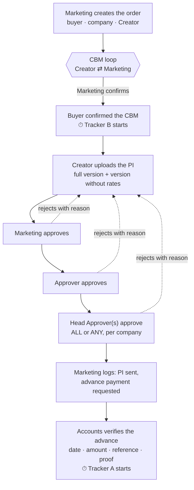
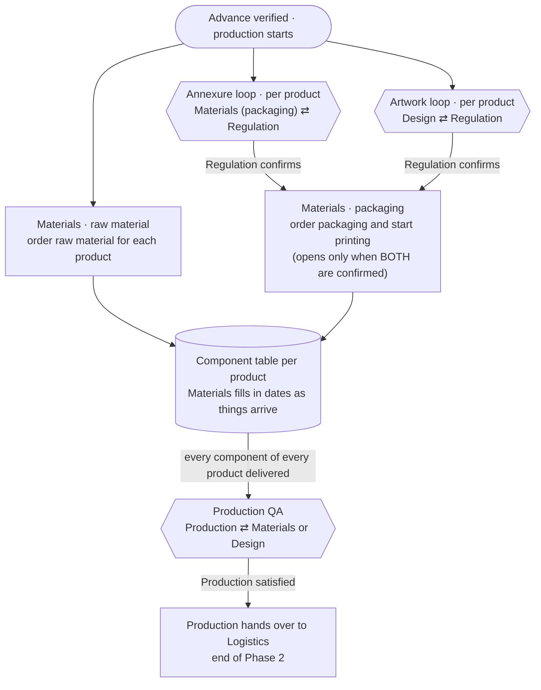
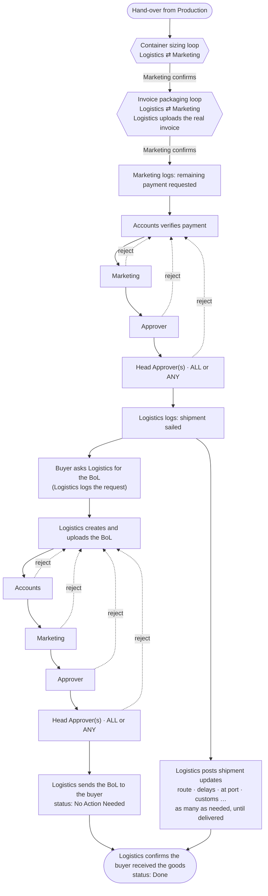

# DocFlow v2 — order workflow (for review before building)

How an export order moves through DocFlow v2, from the buyer's first requirements to the shipment being delivered. This is the proposed flow from `docs/v2-gap-analysis.md`, with the owner's answers of 20 Oct 2026 applied, including the Phase 3 change: shipment tracking starts at sailing, and the BoL is created only when the buyer asks.

**Key:**

| Tag | Meaning |
|---|---|
| **[Team]** | Anyone in that team can do it (Regulation, Materials, Design, Production, Accounts, Logistics) |
| **[Named]** | A specific person, set per company (Creator, Marketing, Approver, Head Approver) |
| **[Loop]** | A back-and-forth where every round is recorded |
| **[Auto]** | The app does it |

The diagrams render on GitHub. In VS Code, use Markdown preview with a Mermaid extension (e.g. "Markdown Preview Mermaid Support").

---

## Phase 1 · Sales and Proforma Invoice

Ends when Accounts confirms the advance payment arrived. That starts production.

1. **[Named] Marketing** creates the order in the app: buyer (from a Buyer list), company, and which Creator drafts it. Talking to the buyer before this happens outside the app.
2. **[Named] Creator ⇄ Marketing [Loop: CBM].** The Creator uploads the CBM (a file). Marketing confirms it or sends it back with a required comment, as many rounds as needed.
3. **[Named] Marketing** presses **"Buyer confirmed CBM"**, with the date. This starts **Tracker B**, and the PI task opens for the Creator automatically.
4. **[Named] Creator** uploads two files, the **full PI** and the **PI without rates, buyer name or address**, and lists the order's products.
5. **[Named] Marketing → Approver → Head Approver(s)** approve in that order. Head Approvers use ALL or ANY, as set for the company. Any of them can reject with a reason: the PI goes back to the Creator, and after the fix the approvals start again from Marketing.
6. **[Named] Marketing** logs that the PI was sent and the advance payment was requested.
7. **[Team] Accounts** verifies the advance arrived (date, amount, reference, optional proof). **Phase 2 starts**, along with **Tracker A**.

---

## Phase 2 · Production

Three tracks start at once for each product. They meet when every material has been delivered, then Production checks quality and hands over to Logistics.

1. **[Team] Materials, tag "raw material":** one task per product, to order the raw materials (API). Nothing holds this up.
2. **[Team] Materials ⇄ Regulation [Loop: annexure], tag "packaging":** for each product, Materials drafts the packaging annexure and Regulation confirms it or returns it with comments.
3. **[Team] Design ⇄ Regulation [Loop: artwork]:** for each product, Design sends the artwork and Regulation confirms it or returns it. This runs independently of the annexure; either can be confirmed first.
4. **[Team] Materials, tag "packaging":** the **"Order packaging and print"** task appears only once that product's annexure **and** artwork are both confirmed.
5. **[Team] Materials** keeps each product's component table up to date at any time until the hand-over to Logistics. A component counts as delivered once its **Deliver Date** is filled in.
6. **[Auto]** When every component of every product is delivered, Production QA opens.
7. **[Team] Production ⇄ Materials or Design [Loop: QA].** Production checks the materials and can send problems back with notes. QA resumes once the fix comes back.
8. **[Team] Production** hands over to Logistics. **End of Phase 2.**

**Who sees which PI** (the server enforces this):

| PI version | Who sees it |
|---|---|
| Without rates | Regulation, Materials, Design |
| Full | Logistics, Accounts, Production |
| Both | Marketing, the approvers, Admin |

---

## Phase 3 · Logistics and shipment

After the remaining payment is approved, the shipment sails and Logistics tracks it. The Bill of Lading is created only when the buyer asks Logistics for it. The order shows **No Action Needed** once Logistics has sent the approved BoL to the buyer, and **Done** once Logistics confirms the buyer received the goods.

1. **[Team] Logistics ⇄ [Named] Marketing [Loop: container sizing]:** container and sizing details, until Marketing confirms.
2. **[Team] Logistics ⇄ [Named] Marketing [Loop: invoice packaging]:** Logistics prepares and uploads the real invoice, as a separate loop, until Marketing confirms.
3. **[Named] Marketing** logs that the remaining payment was requested. This only records the request: Marketing can't confirm that the buyer paid.
4. **Payment check: [Team] Accounts → [Named] Marketing → Approver → Head Approver(s).** Accounts confirms the money arrived, then the three sign off in turn. A rejection goes back to Accounts with the reason, and Marketing chases the buyer.
5. **[Team] Logistics** logs that the **shipment sailed**, with the date. Tracking starts here.
6. **[Team] Logistics** posts shipment updates for as long as the goods are in transit: route, delays, at port, customs, and so on. Each has a status from a list, free text and a date, and there can be any number of them. Updates can be posted at any time until delivery, including while the BoL is being prepared.
7. **[Team] Logistics** logs that the **buyer asked for the BoL**, then creates and uploads it. Nothing happens to the BoL before the buyer asks.
8. **BoL approval: [Team] Accounts → [Named] Marketing → Approver → Head Approver(s).** This chain has its own people and ALL/ANY settings. A rejection goes back to Logistics with the reason, to correct and re-upload the BoL.
9. **[Team] Logistics** sends the approved BoL to the buyer and marks it sent. The status becomes **No Action Needed**.
10. **[Team] Logistics** confirms the buyer received the goods. The status becomes **Done**. Only Logistics can close the order, and only after the BoL has been sent.

---

## What everyone sees

### The three clocks, always shown with their dates

| Tracker | Counts from | Example |
|---|---|---|
| **B** · since the chain started | "Buyer confirmed CBM" | 34 days · since 18 Sep 2026 |
| **A** · since production started | Accounts verifying the advance | 21 days · since 1 Oct 2026 |
| **C** · how long this team has held the task | Only the time the task sat with that team, rounded up to whole days | Materials · annexure for Prod A · 2 days |

In the owner's Tracker C example (Materials day 1, Regulation 3 days, Materials the next day), Materials shows **2 days**. The time with Regulation isn't counted.

### Component table, one per product (example: Prod A, invented rows)

| Sr. | Prod Name | Type | PO Qty | Order Qty | PO Date | Days since PO | Dispatch | Deliver | LR Details | Challan No. | Trident Remark | TNS Remark |
|---|---|---|---|---|---|---|---|---|---|---|---|---|
| 1 | Carton 10×20 | Packaging | 5,000 | 5,100 | 02 Oct | 20 | 14 Oct | 17 Oct ✓ | LR-88231 | CH-4410 | — | 2% extra run |
| 2 | Label, front | Packaging | 5,000 | 4,950 | 02 Oct | 20 | — | waiting | — | — | Reprint asked | — |
| 3 | Paracetamol API | Raw material | 250 kg | 250 kg | 03 Oct | 19 | 10 Oct | 12 Oct ✓ | LR-87110 | CH-4388 | — | — |

- **PO Quantity:** what the buyer ordered on their purchase order. **PO Date:** when they placed it.
- **Order Quantity:** what was actually manufactured, often about 2% more or less.
- **The remarks:** TNS is the manufacturer and Trident the exporter.
- **Editing:** Materials edits every column, both remarks included, from their dashboard. Every change is logged with who and when.

### Dashboards and the live chain view
- **One dashboard per person,** with a tab per team or role and an "All my work" tab. The task waiting longest is at the top.
- **Filters:** buyer, company, dates and stage. Materials can also filter by raw material or packaging (both are shown by default).
- **Live chain view:** any order opens to its whole chain, showing every step and every loop round with who, when and their comment, with today's position highlighted.
- **No emails.** People sign in daily and work from their dashboard.

---

## Please check before building

1. **Order of Phase 1:** is it right that the CBM is confirmed before the PI is drafted, and that the advance comes after PI approval?
2. **Per product:** annexure, artwork, raw-material ordering and packaging ordering each happen once per product, not once per order.
3. **Production waits for everything:** it starts only when every component of every product is delivered, not product by product.
4. **Phase 3 order:** container sizing, then the invoice, then the payment request and payment check, then the shipment sails and is tracked. When the buyer asks, Logistics creates the BoL, it's approved and sent, and then delivery.
5. **Rejections:** a PI rejection goes back to the Creator, a payment rejection goes back to Accounts, and a BoL rejection goes back to Logistics to correct it.
